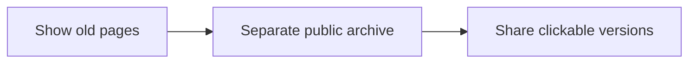

# Promptlog

## 2026-10-29 — Emin

- **Request:** put the whole collection of old landing pages on public GitHub so people can browse different versions — `ec6153e`.
- **Decision:** create a separate public export; keep the private backup and encrypted source-history release private — `ec6153e`.
