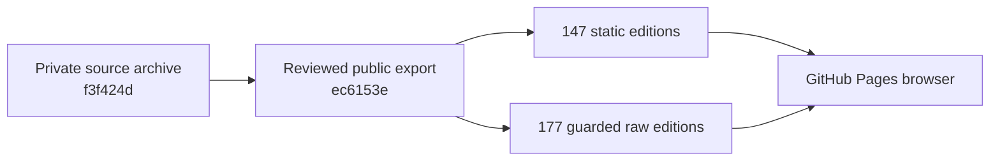
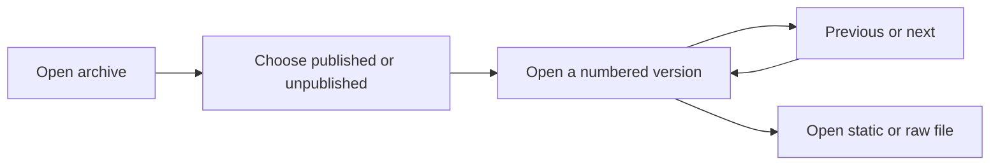

# Nuri Website History

Public, clickable archive of **324 Nuri landing-page versions**: 175 published captures and 149 unpublished designs. It contains 147 self-contained static editions and 177 original-only captures.

**Browse:** https://nuri-com.github.io/nuri-website-history/

## Logs

- [CHANGELOG.md](CHANGELOG.md) — publication changes and releases, with commit SHAs
- [PROMPTLOG.md](PROMPTLOG.md) — distilled owner requests and decisions

## Architecture



## User journey



## Navigate

- **All versions:** `index.html`
- **Previous/next viewer:** `viewer.html?i=0`
- **Current landing-page copy:** `COPY.md`
- **Machine-readable catalogue:** `manifest.json`
- **Published versions:** `published/`
- **Unpublished versions:** `unpublished/`

Static editions are self-contained HTML with scripts removed and assets inlined. Original-only captures are historical material, not guaranteed self-contained renderings. Public raw HTML has script/network guards and every public HTML page is `noindex`; byte-preserved originals remain in the private source archive.

## Provenance and exclusions

Source: private `nuri-com/nuri-website-archive`, commit `f3f424df744cbf9c85a4d5bda02bfed2d8fae422`.

This public export omits encrypted Git bundles, release assets, local capture metadata, local absolute source paths, and the quarantined third-party file. No production website or application is deployed from this repository. Historical public viewing does not grant an open-source license for the archived content.

## Verify

```bash
python3 verify_public.py
```

Expected: 324 versions, 147 static editions, 633 HTML files, zero failures. Browser QA on the export: 147/147 static pages, zero external requests, zero failures after excluding the intentionally different raw-original comparison. GitLeaks: no findings.

## Status

- **Version:** 0.1.0
- **Updated:** 2026-10-29 by Hermes
- **Public export revision:** `ec6153e086e15ad56b33e14641577d2b18a1dbdb`
- **Deployment:** GitHub Pages, https://nuri-com.github.io/nuri-website-history/
